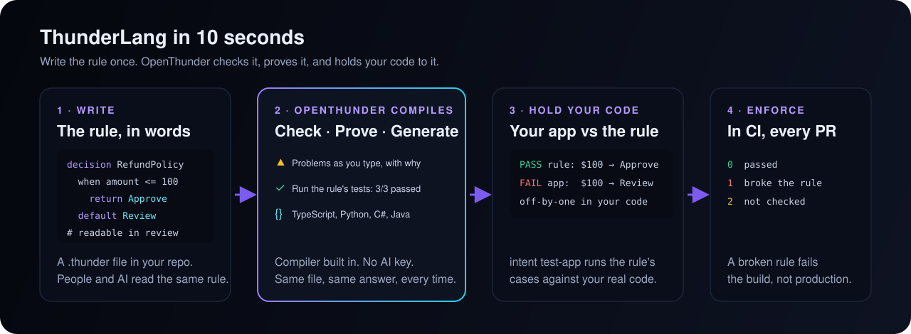

<p align="center">
  
</p>

<p align="center">
  <a href="https://www.npmjs.com/package/@skillstech/thunderlang"></a>
  <a href="./LICENSE"></a>
  <a href="https://thunderlang.dev/try"></a>
  <a href="https://openthunder.dev"></a>
</p>

**ThunderLang is a small language for writing down what your software must decide and must never do, in words a
person can read.** A real compiler checks it, runs its tests, and turns it into code. **OpenThunder is where you
write it:** the compiler is built in.

<p align="center">
  
</p>

## Why it exists

AI can write a thousand lines in a minute, but code does not say what it was supposed to do. A chat prompt is gone
once the work is done, and a spec in a document cannot be run. A ThunderLang rule stays in your repository, reads
like a sentence in a review, and can be proven by a machine. That gives your AI agents, your team, and your CI one
shared definition of correct.

## See it in 20 seconds

```thunder
decision RefundPolicy
  inputs
    amount
    withinWindow
  rule small-refund
    when amount <= 100 and withinWindow
    return Approve
  default
    return Review

test RefundPolicy
  case at-the-limit
    given amount 100, withinWindow true
    expect Approve
  case over-the-limit
    given amount 101, withinWindow true
    expect Review
  case outside-the-window
    given amount 50, withinWindow false
    expect Review
```

```text
$ thunder test Refund.thunder
thunder test Refund.thunder: 3/3 passed
  PASS  RefundPolicy / at-the-limit
  PASS  RefundPolicy / over-the-limit
  PASS  RefundPolicy / outside-the-window

$ thunder gen Refund.thunder --target typescript
export function refundPolicy(amount: unknown, withinWindow: unknown): string {
  if (((amount <= 100) && withinWindow)) return "Approve"; // rule small-refund
  return "Review"; // default
}
```

The compiler explains its findings instead of just flagging them:

```text
[warning] never-without-verification: Never rule "approve a refund outside the refund window" has no explicit verification.
    why: A never rule forbids behavior, but without a check nothing enforces it in the real implementation.
    fix: Attach a verify check (for example a security scan)
```

## Write it in OpenThunder

[OpenThunder](https://openthunder.dev) is the AI IDE that compiles ThunderLang. Open any `.thunder` file and the
compiler panel opens beside it:

| | What you get |
|---|---|
| **Problems** | Checked as you type, each with the reason, marked in the editor. |
| **Tests** | Run the file's `test` blocks. A failing case says what it expected and what it got. |
| **Generate code** | The same rules as TypeScript, Python, C#, or Java, ready to copy. |
| **Your app vs the rule** | `openthunder intent test-app` runs the rule's cases against your real code. In the [refund walkthrough](https://openthunder.dev/docs/refund-contract.html) it catches a $100 off-by-one in the app while the rule itself passes. |
| **In CI** | Exit code 0 passed, 1 broke the rule, 2 not checked. |

[Download OpenThunder Desktop](https://openthunder.dev) (Mac, Windows, Linux) or use
[OpenThunder Cloud](https://app.openthunder.ai) in the browser. No AI key is needed for any of the above.

## Or use the CLI

```bash
npm install -g @skillstech/thunderlang
thunder init Eligibility                              # a runnable starter
thunder run Eligibility.thunder --inputs '{"age":20}'  # a decision decides, with a trace
thunder test Eligibility.thunder                       # in-file tests prove it
thunder check .                                       # check every .thunder in the repo
```

Some intent does not need code generated at all: it runs. A decision evaluates against inputs, a lifecycle
simulates against events, and an outcome contract is judged against a result, all deterministically. Start with
[Getting started](./docs/getting-started.md).

## What is in this repository

- **`compiler/`**: the deterministic compiler, CLI, and language server, published as
  [`@skillstech/thunderlang`](https://www.npmjs.com/package/@skillstech/thunderlang). Runtime, in-file tests,
  outcome contracts, security and type checks, code generation, export adapters (DMN, BPMN, NuSMV, JSON Schema,
  OpenAPI, design tokens, CSS, Mermaid, Playwright), a proof envelope, and SARIF output.
- **`editors/vscode/`**: a VS Code extension (grammar and language client).
- **`src/`, `docs/`, `examples/`**: the [thunderlang.dev](https://thunderlang.dev) website, the docs, and worked
  examples. Working on the website: [WEBSITE.md](./WEBSITE.md).

Read more: [Spec](./docs/spec.md) · [Manifesto](./docs/manifesto.md) · [Editor support](./docs/editor-support.md)

## Status

Pre-1.0 and honest. The compiler is real, deterministic, and tested (780+ tests, including fuzz, property, and
composition tests, with CI guards for checks, docs, schema sync, and formatting). The language and its
`intent-graph-v1` schema are versioned separately and can still change before 1.0. ThunderLang sits above
programming languages; it does not replace TypeScript, Python, Java, .NET, Rust, or Go.

ThunderLang™ and OpenThunder™ are trademarks of Skills Tech Talk, LLC. The code is licensed under
[Apache 2.0](./LICENSE); see [TRADEMARKS.md](./TRADEMARKS.md) for use of the names.
