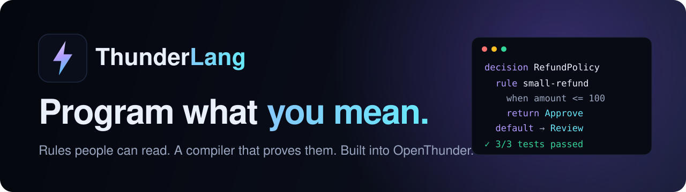
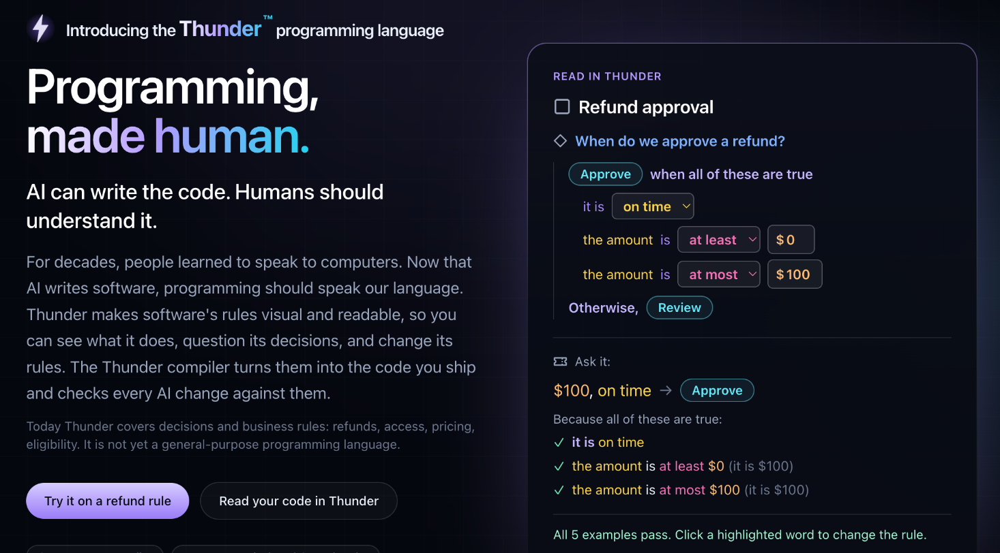
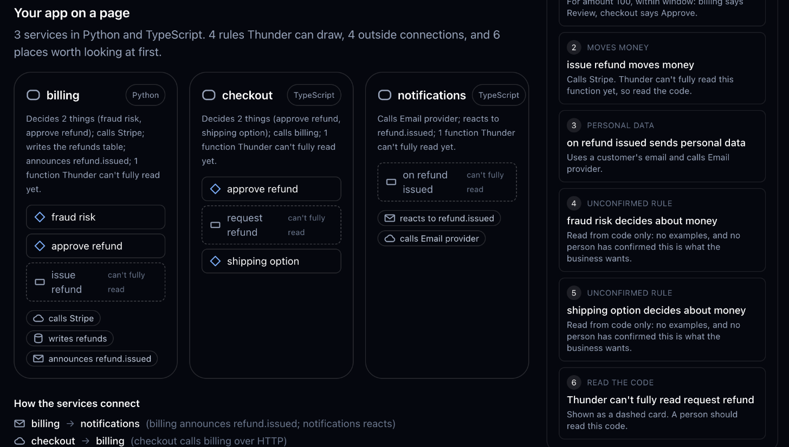
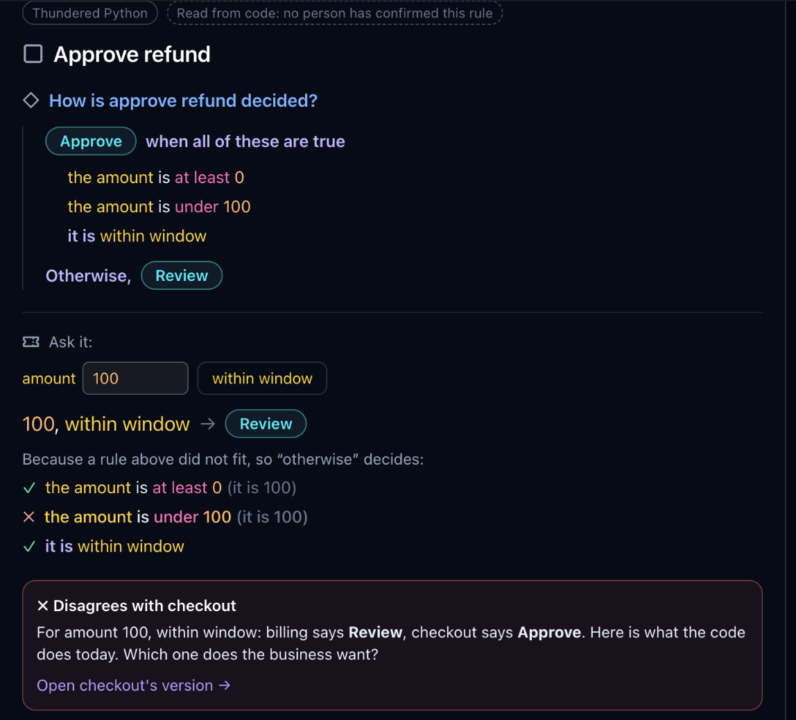

<p align="center">
  
</p>

<p align="center">
  <a href="https://www.npmjs.com/package/@skillstech/thunderlang"></a>
  <a href="./LICENSE"></a>
  <a href="https://thunderlang.dev/try"></a>
  <a href="https://thunderlang.dev/map"></a>
  <a href="https://openthunder.dev"></a>
</p>

# Thunder™: programming, made human

**Thunder™ (also called ThunderLang™) is a visual language for reading and changing the rules in software.**
AI can write the code; humans should understand it. Thunder shows a rule as a picture you can read, ask, and
change, and a real compiler checks it, runs its examples, and turns it into the code you ship. Think Go and
Golang: one language, two names.

> **AI should handle the complexity of writing software. Humans should keep the clarity and control to understand it.**

Today Thunder covers decisions and business rules (refunds, access, pricing, eligibility). It is not yet a
general-purpose programming language.

## Read it. Understand it. Change it.

<p align="center">
  
</p>

| | What you do | What Thunder does |
|---|---|---|
| **Read** | Look at the rule as a picture | The question it answers, the facts it reads, the outcomes, in plain words and meaningful colors |
| **Understand** | Ask it about a real case | Answers with the reason: ✓ or ✗ for every condition, computed by the real compiler |
| **Change** | Click a word ("at most" to "under") | Shows which examples change their answer *before* you apply, then regenerates the code |

[Try it on a refund rule →](https://thunderlang.dev/try)

### Colors mean something

One color per kind of word, everywhere: **facts** yellow, **comparisons** pink, **amounts** orange,
**outcomes** cyan, **structure** violet. Green ✓ and red ✗ mean only *passes* or *fails*. A dashed outline means
*not established yet*. Four shapes: a **square** is a contract, a **diamond** is a decision, a **rounded label**
is an outcome, a **ticket** is an example you can run.

## Thunder Code: read the code you already have

Thunder reads existing Python, TypeScript, JavaScript, Java, C#, Go, Rust, Kotlin, PHP, and Ruby (all 10 languages the code reader supports today) and draws the rules it finds.
That is **Thundered code**: "Thundered Python", "Thundered TypeScript". Your code stays the source of truth;
Thunder shows what it does today, so a person can say whether that is what the team wants.

```python
def Refund(amount: float, withinWindow: bool) -> str:
    if (((amount >= 0) and (amount <= 100)) and withinWindow):
        return "Approve"
    return "Review"
```

becomes a Thunder card: *Approve when the amount is at least 0, the amount is at most 100, and it is within
window; otherwise Review*, labeled **read from code** until a person confirms what it should mean.
[Read your code in Thunder →](https://thunderlang.dev/read)

## Thunder Atlas: a whole app, from the big picture to one rule

<p align="center">
  
</p>

The Thunder Atlas reads a whole app in Thunder: a **Thunder Brief** (one-paragraph summary), a **Thunder Map** of how it is built (services as areas, outside connections: clouds for APIs, cylinders for databases, envelopes for events), colors you can click to light up every place a fact or
outcome is used, and **Thunder Focus**, a ranked "look here first" list: disagreements, money, personal data, unconfirmed rules,
and code Thunder can't read yet. Zoom into any rule:

<p align="center">
  
</p>

In the sample, Thunder finds that **checkout approves exactly $100 but billing sends it to review**, and asks the
only question that matters: *which one does the business want?* [See the Thunder Atlas →](https://thunderlang.dev/map)
(prototype: the rules come from the real code reader; service connections use simple patterns that OpenThunder's
discovery replaces).

## OpenThunder: the IDE for Thunder

**Thunder is the language. [OpenThunder™](https://openthunder.dev) is where you use it on your app.** Open your
repository, read it in Thunder, find your way around it, learn it, change it, and verify every change. The Thunder
compiler is built in.

| Mode | | Status |
|---|---|---|
| **Read** | Thundered TypeScript, Python, and more, as Thunder pictures | Preview |
| **Navigate** | The Thunder map: from the whole app to one rule, with where to look first | Prototype |
| **Learn** | Memorize your app with questions built from its real rules, and relearn when a rule changes | Planned |
| **Change** | **Thunder write**: change the picture; OpenThunder patches and checks the original code | Planned |
| **Verify** | Every change, by a person or an AI, checked against your rules before it merges | Available |

Until Thunder write ships, a Thundered rule offers **Propose rule change**, never "Update code". Nothing is ever
transformed silently.

## Thunder Text, the compiler, and the CLI

**Thunder Text** is the interim written form: a Thunder picture in readable, structured words, saved so it can be
versioned, reviewed, and compiled. You never need to read it, but you can:

```text
Refund approval
Why: Let support resolve small refunds without waiting for a manager.

We need
  the amount, in dollars
  whether it is on time or late

When do we approve a refund?
  Approve when all of these are true:
    it is on time
    the amount is at least $0
    the amount is at most $100
  Otherwise, Review.

Examples
  $100, on time   gives Approve   (exactly at the limit)
  $50, late       gives Review    (outside the refund window)
```

```bash
npm install -g @skillstech/thunderlang
thunder text RefundApproval.thunder-plain                     # run a Thunder Text rule's examples (experimental)
thunder text RefundApproval.thunder-plain --format source     # the Thunder source it compiles to
thunder test Rules.thunder                                    # in-file examples prove the rule
thunder gen Rules.thunder --target python                     # TypeScript, Python, C#, or Java
thunder verify-diff Rules.thunder --before old.ts --after new.ts   # block an AI change that breaks a rule
```

`thunder text` (alias `thunder plain`) ships in the next release of `@skillstech/thunderlang`; until then run it from
this repository with `node compiler/src/cli.mjs text <file>`.

The compiler is deterministic (no AI, no key, no network) and explains its findings instead of just flagging them:

```text
[warning] never-without-verification: Never rule "approve a refund outside the refund window" has no explicit verification.
    why: A never rule forbids behavior, but without a check nothing enforces it in the real implementation.
    fix: Attach a verify check (for example a security scan)
```

Some rules don't need code generated at all: a decision evaluates against inputs, a lifecycle simulates against
events, and an outcome contract is judged against a result. Start with
[Getting started](./docs/getting-started.md) or the [10-minute tutorial](https://thunderlang.dev/learn).

## Words we use

| Word | Meaning |
|---|---|
| **Thunder™** | The Thunder programming language: the visual language people read and change rules in |
| **ThunderLang™** | Another name for Thunder, like Golang for Go (the site, the npm package, this repository) |
| **Thunder compiler** | The open-source compiler and `thunder` CLI in this repository |
| **Thunder Text** | The interim written form: a Thunder picture in readable words, stored and reviewed like code |
| **Thundered code** | Existing code shown in Thunder: Thundered Python, Thundered TypeScript |
| **Thunder read / Thunder write** | Reading code visually / changing code visually, verified (write is planned) |
| **OpenThunder™** | The IDE for Thunder: read, navigate, learn, change, and verify your app |

Ways to see your software in Thunder (agreed with OpenThunder): **Thunder Atlas** (zoom from product to rule to
code), **Thunder Map** (how the code is built), **Thunder Code** (every function in a file or folder), **Thunder
Trace** (one user action, start to data), **Thunder Brief** (the big picture), **Thunder Focus** (where to look
first), **Thunder Learn / Practice** (memorize your app), and **Thunder Review** (a pull request as pictures, later).

More: [Thunder vocabulary](./docs/thunder-vocabulary.md) · [Language principles](./docs/language-principles.md)

## What is in this repository

- **`compiler/`**: the deterministic Thunder compiler, CLI, and language server, published as
  [`@skillstech/thunderlang`](https://www.npmjs.com/package/@skillstech/thunderlang). Runtime, in-file tests,
  outcome contracts, code readers for 10+ languages, plain Thunder (`thunder-plain-v1`), security and type checks,
  code generation, export adapters (DMN, BPMN, NuSMV, JSON Schema, OpenAPI, design tokens, CSS, Mermaid,
  Playwright), a proof envelope, and SARIF output.
- **`editors/vscode/`**: a VS Code extension (grammar and language client).
- **`src/`, `docs/`, `examples/`**: the [thunderlang.dev](https://thunderlang.dev) website (including the visual
  Thunder card and the Thunder map), the docs, and worked examples. Working on the website: [WEBSITE.md](./WEBSITE.md).

Read more: [Thunder V1 spec](./docs/spec.md) · [Manifesto](./docs/manifesto.md) · [Editor support](./docs/editor-support.md)

## Status

Pre-1.0 and honest. The compiler is real, deterministic, and tested (775+ compiler tests, including fuzz,
property, and composition tests, with CI guards for checks, docs, schema sync, and formatting). The visual card,
plain notation, and Thunder map are experimental. Whether Thunder is easier to read than Python for
non-programmers is a hypothesis we are testing, not a claim. Thunder sits above programming languages; it reads
and targets TypeScript, Python, Java, .NET, Rust, and Go rather than replacing them.

Thunder™, ThunderLang™, and OpenThunder™ are trademarks of Skills Tech Talk, LLC. The code is licensed under
[Apache 2.0](./LICENSE); see [TRADEMARKS.md](./TRADEMARKS.md) for use of the names.
